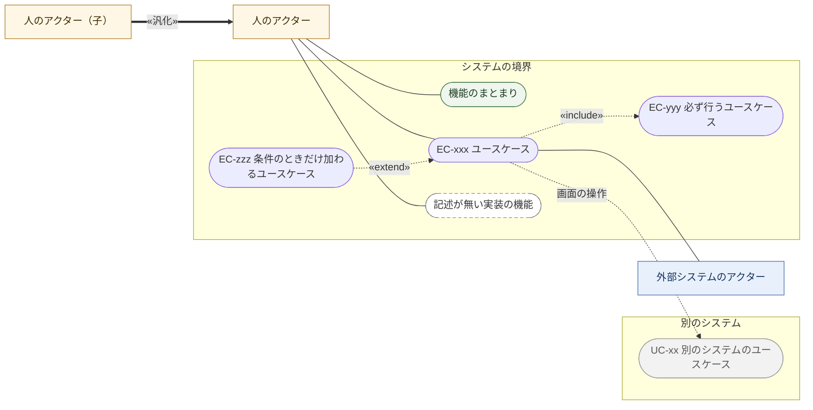
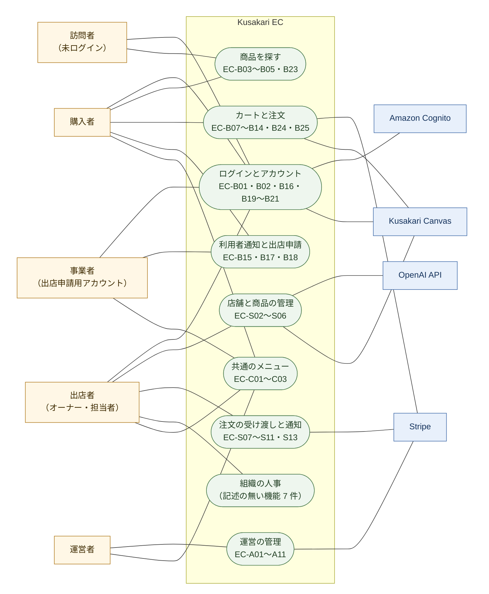
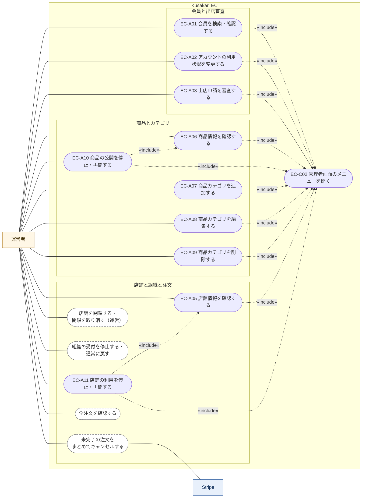
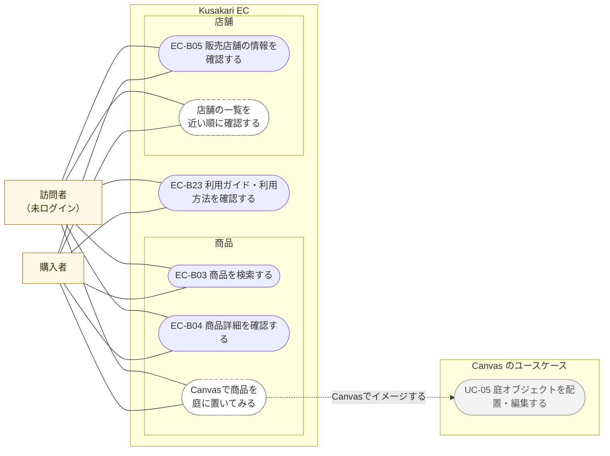
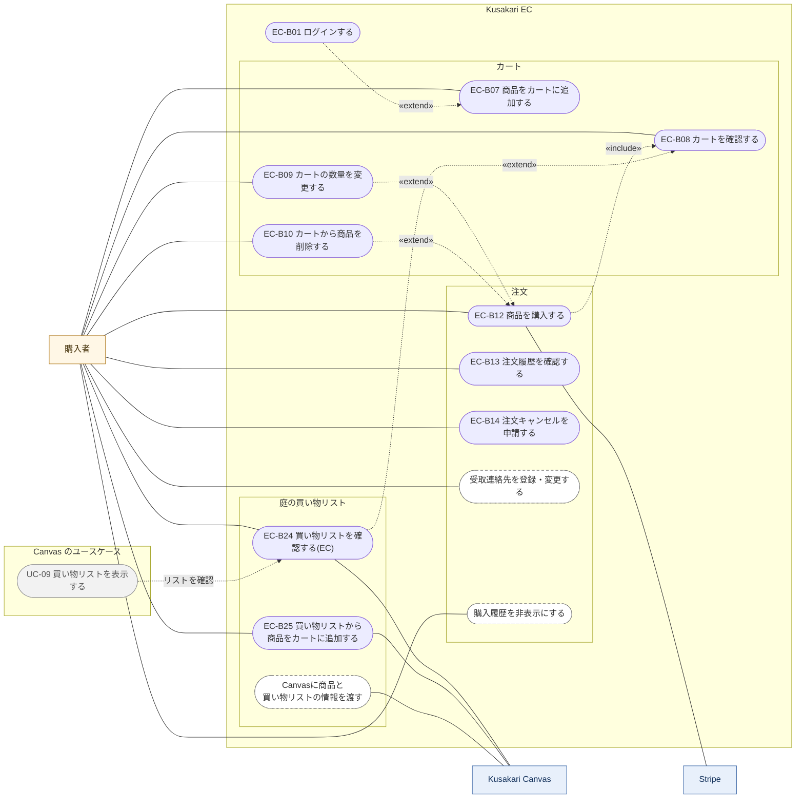
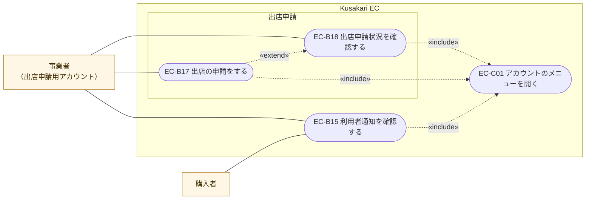
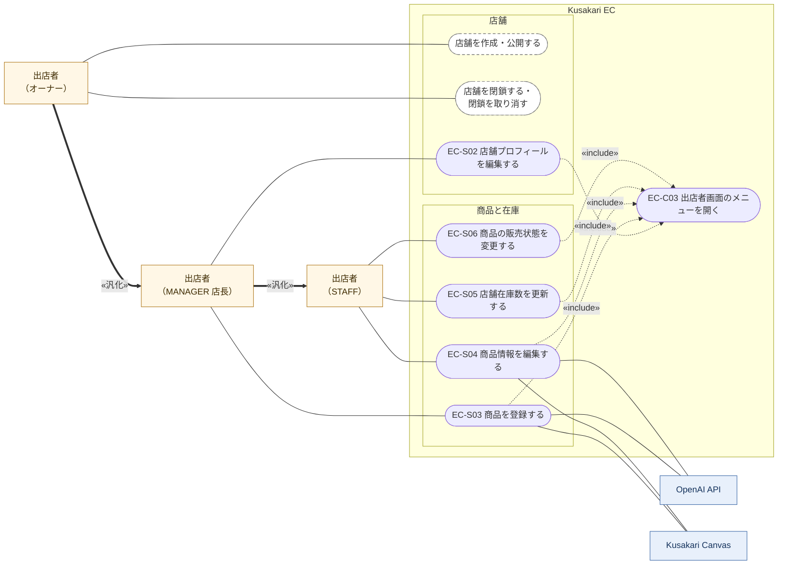
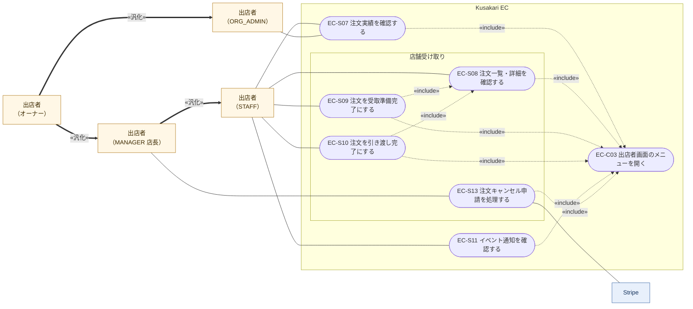
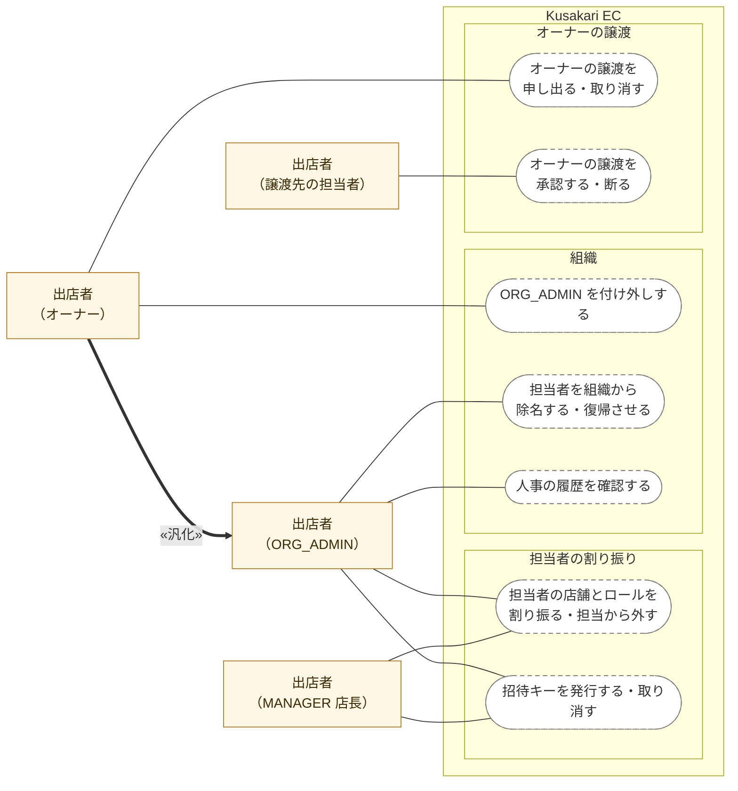
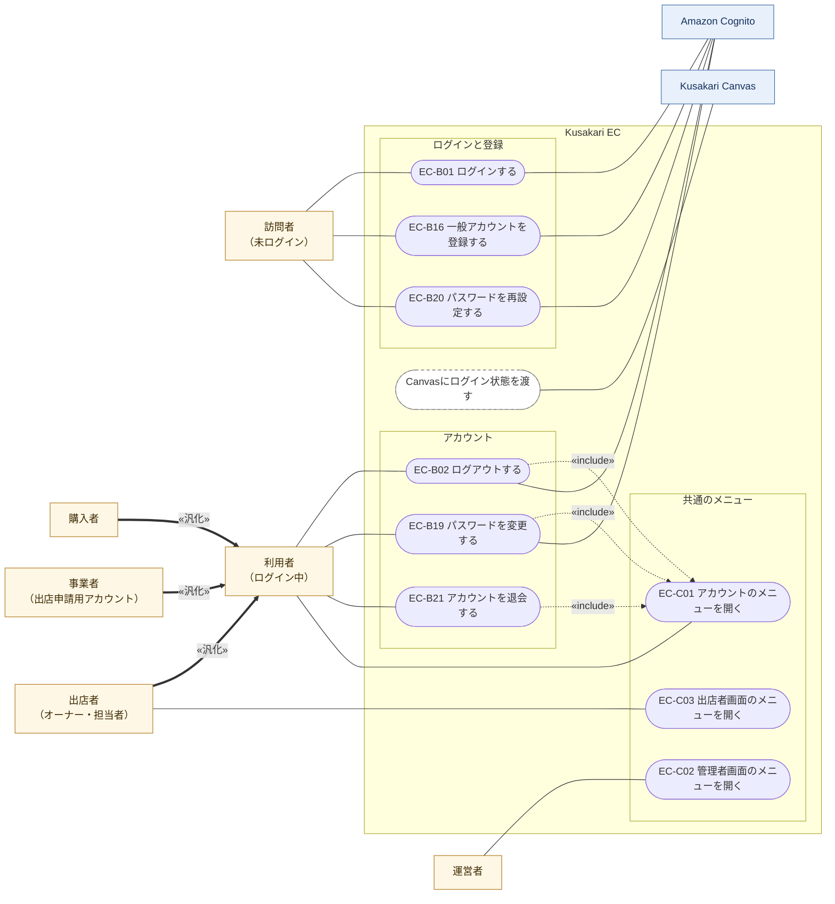

# Kusakari EC ユースケース図

Kusakari EC のユースケース図です。ユースケース記述と今の実装から起こしています。ユースケース記述が無いが実装にある利用者向けの機能も、ID を付けずに載せています。

## 対象のコード

- kusakari-ec の main、コミット 19a2be3（2026-11-20 時点）です。画面は `frontend/src`、API は `backend/src/main/java/jp/kusakari/ec`、DB は `backend/src/main/resources/db/migration` の V1〜V6、仕様は `docs/` を見ています。
- EC とやりとりする Canvas 側のコードは、kusakari-canvas の main、コミット c19d497（2026-11-20 時点）で確かめています。
- 元のユースケース記述は [アーカイブ/ユースケース/kusakari-ec](<../../アーカイブ/ユースケース/kusakari-ec>) にあります。[全ユースケース共通の代替フロー](<../../アーカイブ/ユースケース/kusakari-ec/00_全ユースケース共通の代替フロー.md>) も含めています。
- EC と Canvas をまたぐ図は [EC と Canvas の全体](<../00_ECとCanvasの全体.md>)、Canvas の図は [Kusakari Canvas ユースケース図](<../kusakari-canvas/Canvas_ユースケース図.md>) にあります。

## 凡例

| 書き方 | 意味 |
| --- | --- |
| 黄色の四角 | 人のアクターです（訪問者、購入者、事業者、出店者、運営者）。 |
| 青の四角 | 外部システムのアクターです（Amazon Cognito、Stripe、OpenAI API、Kusakari Canvas）。 |
| 角の丸い枠（緑） | ユースケースのまとまりです。1 の全体の図だけで使います。 |
| 角の丸い枠（実線） | ユースケース記述があるユースケースです。ID と名前を書きます。 |
| 角の丸い枠（白地に点線） | ユースケース記述は無いが、実装にある利用者向けの機能です。ID はありません。 |
| 角の丸い枠（灰色） | 別のシステム（Kusakari Canvas）のユースケースです。 |
| 外側の枠 | システムの境界（Kusakari EC）です。中の枠は機能のまとまりです。 |
| 実線 | アクターがそのユースケースにかかわります。 |
| 太い矢印「«汎化»」 | 矢印の元のアクターは、矢印の先のアクターのユースケースもすべて行えます。 |
| 点線の矢印「«include»」 | 矢印の元のユースケースが、基本フローの中で矢印の先のユースケースを必ず行います。 |
| 点線の矢印「«extend»」 | 矢印の元のユースケースが、条件のときだけ矢印の先のユースケースに加わります。 |
| 点線の矢印（そのほかのラベル） | その操作で、別のシステムのユースケースへ画面が移ります。ラベルはボタンの文言か操作の名前です。 |

- include と extend は、ユースケース記述の基本フロー・代替フローにある参照（「(EC-C02)」など）から引き、コードで確かめています。
- 次の参照は線にせず、ユースケース一覧の「関係」の列に書きます。関連情報で分担だけを書いている参照、事前条件でつながるだけのユースケース、「(EC-S11)」「(EC-B15)」のように通知の届け先を示す参照です。
- 記述の無い機能の線は、コードで確かめた動きから引いています。
- 共通代替フロー（*a 通信に失敗した場合、*b 未ログインの場合）は線にしません。

## アクター

| アクター | 実装での種類やロール | 説明 | 根拠のコード |
| --- | --- | --- | --- |
| 訪問者（未ログイン） | 種類なし（`GET /api/auth/me` が `authenticated=false` を返す状態） | 商品一覧・商品詳細・店舗紹介・利用ガイドを見られます。ログイン（EC-B01）、新規登録（EC-B16）、パスワードの再設定（EC-B20）も、このアクターで書きます。アカウントを持つ人（購入者・事業者・出店者・運営者）も、ログインする前は訪問者です。カートに入れようとするとログイン画面へ移ります。 | [AuthConfiguration.java の未ログインで使える API](https://github.com/abeouga/kusakari-ec/blob/19a2be307ee71a2cd87e538236c3c8c42929c5b3/backend/src/main/java/jp/kusakari/ec/auth/AuthConfiguration.java#L99-L127)、[Workspace.jsx](https://github.com/abeouga/kusakari-ec/blob/19a2be307ee71a2cd87e538236c3c8c42929c5b3/frontend/src/workspace/Workspace.jsx#L140-L153) |
| 購入者 | `members.account_type` が `USER` | カート・注文・庭の買い物リスト・利用者通知を使います。種別が `ADMIN` の運営者も、カート・注文・庭の買い物リストを使えます。図では購入者にまとめています。 | [V1__schema.sql の CHECK 制約](https://github.com/abeouga/kusakari-ec/blob/19a2be307ee71a2cd87e538236c3c8c42929c5b3/backend/src/main/resources/db/migration/V1__schema.sql#L20-L21)、[AuthService.java の requireBuyer](https://github.com/abeouga/kusakari-ec/blob/19a2be307ee71a2cd87e538236c3c8c42929c5b3/backend/src/main/java/jp/kusakari/ec/auth/AuthService.java#L204-L214) |
| 事業者（出店申請用アカウント） | `SHOP_OWNER_APPLICANT` | 新規登録で「企業様向け」を選んで作ったアカウントです。出店の申請（EC-B17）と申請状況の確認（EC-B18）をします。カート・注文・庭の買い物リストは使えません（API は 403 の `BUYER_REQUIRED` を返します）。承認されると出店者（オーナー）になります。シーケンス図と同じく「事業者」と書きます。 | [Workspace.jsx の「出店をご検討の方」](https://github.com/abeouga/kusakari-ec/blob/19a2be307ee71a2cd87e538236c3c8c42929c5b3/frontend/src/workspace/Workspace.jsx#L111-L123)、[auth.js の isShopAccount](https://github.com/abeouga/kusakari-ec/blob/19a2be307ee71a2cd87e538236c3c8c42929c5b3/frontend/src/auth.js#L13-L18) |
| 出店者（オーナー） | `SHOP_OWNER`。`organizations.owner_member_id` で組織と結び付きます。 | 組織のすべての店舗のすべての操作をします。店舗の作成・公開・閉鎖、ORG_ADMIN の付け外し、オーナーの譲渡の申し出は、オーナーだけが行います。図では、出店者（MANAGER 店長）と出店者（ORG_ADMIN）を汎化の先にしています。 | [V1__schema.sql の organizations](https://github.com/abeouga/kusakari-ec/blob/19a2be307ee71a2cd87e538236c3c8c42929c5b3/backend/src/main/resources/db/migration/V1__schema.sql#L45-L59)、[StaffPolicy.java の権限の表](https://github.com/abeouga/kusakari-ec/blob/19a2be307ee71a2cd87e538236c3c8c42929c5b3/backend/src/main/java/jp/kusakari/ec/store/service/StaffPolicy.java#L18-L40) |
| 出店者（MANAGER 店長） | `SHOP_STAFF` で、`store_members.role` が `MANAGER` | 担当する店舗の商品の登録・削除、店舗プロフィールの編集、キャンセル申請への回答と、STAFF の操作をします。自分の店舗の担当者に STAFF とロールなしを割り振り、招待キーを発行します。図では、出店者（STAFF）を汎化の先にしています。 | [V1__schema.sql の store_members](https://github.com/abeouga/kusakari-ec/blob/19a2be307ee71a2cd87e538236c3c8c42929c5b3/backend/src/main/resources/db/migration/V1__schema.sql#L137-L150)、EC-C03 の関連情報 |
| 出店者（STAFF） | `SHOP_STAFF` で、`store_members.role` が `STAFF` | 担当する店舗の商品の編集・公開状態・在庫の変更、注文の受け渡し、注文実績の確認をします。 | 同上 |
| 出店者（ORG_ADMIN） | `SHOP_STAFF` で、`organization_members.role` が `ORG_ADMIN` | 組織の人事の担当です。組織の全員のアカウント一覧、全店舗の MANAGER・STAFF の割り振り、招待キー、除名と復帰、人事の履歴を扱います。閉鎖済みの店舗の注文実績も見られます。商品・在庫・注文は、店舗のロールに従います。 | [V1__schema.sql の organization_members](https://github.com/abeouga/kusakari-ec/blob/19a2be307ee71a2cd87e538236c3c8c42929c5b3/backend/src/main/resources/db/migration/V1__schema.sql#L92-L107)、[StaffPolicy.java](https://github.com/abeouga/kusakari-ec/blob/19a2be307ee71a2cd87e538236c3c8c42929c5b3/backend/src/main/java/jp/kusakari/ec/store/service/StaffPolicy.java#L18-L40)、[StoreCapabilityPolicy.java](https://github.com/abeouga/kusakari-ec/blob/19a2be307ee71a2cd87e538236c3c8c42929c5b3/backend/src/main/java/jp/kusakari/ec/auth/StoreCapabilityPolicy.java#L14-L17) |
| 出店者（譲渡先の担当者） | `SHOP_STAFF`（ロールは問いません）で、`organizations.pending_owner_member_id` に入った人 | オーナーから譲渡を申し出られた担当者です。通知から承認するか断ります。 | [V6__owner_succession.sql](https://github.com/abeouga/kusakari-ec/blob/19a2be307ee71a2cd87e538236c3c8c42929c5b3/backend/src/main/resources/db/migration/V6__owner_succession.sql#L6-L8)、[StaffPolicy.java](https://github.com/abeouga/kusakari-ec/blob/19a2be307ee71a2cd87e538236c3c8c42929c5b3/backend/src/main/java/jp/kusakari/ec/store/service/StaffPolicy.java#L33) |
| 出店者（オーナー・担当者） | `SHOP_OWNER`・`SHOP_STAFF` の全体 | 上の 5 つをまとめた呼び方です。ロールなしの担当者（`store_members.role` が NULL）もここに入ります。ロールなしの担当者は、所属する店舗の店舗情報と商品一覧・在庫を見られるだけで、注文は見られません。 | [auth.js の canSell](https://github.com/abeouga/kusakari-ec/blob/19a2be307ee71a2cd87e538236c3c8c42929c5b3/frontend/src/auth.js#L9-L11)、[docs/member-roles.md](https://github.com/abeouga/kusakari-ec/blob/19a2be307ee71a2cd87e538236c3c8c42929c5b3/docs/member-roles.md) |
| 利用者（ログイン中） | 購入者・事業者・出店者 | ユースケース記述の「利用者」です。ログアウト、パスワード変更、退会、アカウントのメニューで使います。図では、購入者・事業者・出店者（オーナー・担当者）の汎化の先にしています。 | EC-C01 の基本フロー 2、EC-B21 の関連情報 |
| 運営者 | `ADMIN` | 管理者画面のすべての操作をします。コードでは出店者画面も開けて、全店舗を選べます。図では、ユースケース記述どおり管理者画面の操作だけを線にしています。運営者は退会できません（EC-B21 の関連情報）。 | [auth.js の canSell](https://github.com/abeouga/kusakari-ec/blob/19a2be307ee71a2cd87e538236c3c8c42929c5b3/frontend/src/auth.js#L9-L11)、[Workspace.jsx の権限の確認](https://github.com/abeouga/kusakari-ec/blob/19a2be307ee71a2cd87e538236c3c8c42929c5b3/frontend/src/workspace/Workspace.jsx#L154-L162) |
| Amazon Cognito | 外部システム | ログイン・新規登録・パスワード変更・パスワード再設定・ログアウトを行います。 | 次の表 |
| Stripe | 外部システム | カード決済（テストモード）と返金を行います。 | 次の表 |
| OpenAI API | 外部システム | 商品の登録・編集の「AIで生成」で、植物の特徴を推定します。API キーが無いときは 503 の `AI_NOT_CONFIGURED` を返し、手で入力します。 | 次の表 |
| Kusakari Canvas | 外部システム | 庭の買い物リスト・サムネイル・植物モデルを EC に渡し、EC の商品とログイン状態を使います。 | 次の表 |

### 外部システムとのやりとり

| 外部システム | やりとり | 向き | かかわるユースケース | 根拠のコード |
| --- | --- | --- | --- | --- |
| Amazon Cognito | パスワードでのログイン（`InitiateAuth`）と、トークンの更新 | EC API → Cognito | EC-B01（トークンの更新はログイン中のすべて） | [CognitoPasswordLogin.java](https://github.com/abeouga/kusakari-ec/blob/19a2be307ee71a2cd87e538236c3c8c42929c5b3/backend/src/main/java/jp/kusakari/ec/auth/CognitoPasswordLogin.java#L157-L171)、[トークンの更新](https://github.com/abeouga/kusakari-ec/blob/19a2be307ee71a2cd87e538236c3c8c42929c5b3/backend/src/main/java/jp/kusakari/ec/auth/CognitoPasswordLogin.java#L108) |
| Amazon Cognito | 新規登録と確認コード（`SignUp`・`ConfirmSignUp`・`ResendConfirmationCode`） | EC API → Cognito | EC-B16 | [CognitoSignup.java](https://github.com/abeouga/kusakari-ec/blob/19a2be307ee71a2cd87e538236c3c8c42929c5b3/backend/src/main/java/jp/kusakari/ec/auth/CognitoSignup.java#L61-L86) |
| Amazon Cognito | パスワード変更（`ChangePassword`） | EC API → Cognito | EC-B19 | [CognitoPasswordLogin.java](https://github.com/abeouga/kusakari-ec/blob/19a2be307ee71a2cd87e538236c3c8c42929c5b3/backend/src/main/java/jp/kusakari/ec/auth/CognitoPasswordLogin.java#L118-L141) |
| Amazon Cognito | パスワード再設定・追加の本人確認・ログアウトの画面（Managed Login） | ブラウザー → Cognito の画面 | EC-B20、EC-B01 の代替フロー 7d、EC-B02 | [AuthController.java の /login と /reset](https://github.com/abeouga/kusakari-ec/blob/19a2be307ee71a2cd87e538236c3c8c42929c5b3/backend/src/main/java/jp/kusakari/ec/auth/AuthController.java#L34-L60)、[AuthUrls.java の logout](https://github.com/abeouga/kusakari-ec/blob/19a2be307ee71a2cd87e538236c3c8c42929c5b3/backend/src/main/java/jp/kusakari/ec/auth/AuthUrls.java#L52-L53) |
| Stripe | カード決済（PaymentIntent）と、支払い結果の Webhook（`POST /api/payments/stripe/webhook`） | EC API → Stripe、Stripe → EC API | EC-B12（代替フロー 5a） | [StripeGateway.java](https://github.com/abeouga/kusakari-ec/blob/19a2be307ee71a2cd87e538236c3c8c42929c5b3/backend/src/main/java/jp/kusakari/ec/payment/service/StripeGateway.java#L55)、[PaymentController.java](https://github.com/abeouga/kusakari-ec/blob/19a2be307ee71a2cd87e538236c3c8c42929c5b3/backend/src/main/java/jp/kusakari/ec/payment/controller/PaymentController.java#L35) |
| Stripe | 返金 | EC API → Stripe | EC-S13、未完了の注文をまとめてキャンセルする | [StripeGateway.java の createRefund](https://github.com/abeouga/kusakari-ec/blob/19a2be307ee71a2cd87e538236c3c8c42929c5b3/backend/src/main/java/jp/kusakari/ec/payment/service/StripeGateway.java#L96)、[RefundService.java](https://github.com/abeouga/kusakari-ec/blob/19a2be307ee71a2cd87e538236c3c8c42929c5b3/backend/src/main/java/jp/kusakari/ec/payment/service/RefundService.java#L57)、[OpenOrders.java](https://github.com/abeouga/kusakari-ec/blob/19a2be307ee71a2cd87e538236c3c8c42929c5b3/backend/src/main/java/jp/kusakari/ec/store/service/OpenOrders.java#L56-L64) |
| OpenAI API | 植物の特徴の推定（画面からは `POST /api/products/plant-model-suggestions`） | EC API → OpenAI API | EC-S03（代替フロー 15a）、EC-S04 | [PlantSuggestionController.java](https://github.com/abeouga/kusakari-ec/blob/19a2be307ee71a2cd87e538236c3c8c42929c5b3/backend/src/main/java/jp/kusakari/ec/catalog/controller/PlantSuggestionController.java#L17)、[PlantSuggestionClient.java](https://github.com/abeouga/kusakari-ec/blob/19a2be307ee71a2cd87e538236c3c8c42929c5b3/backend/src/main/java/jp/kusakari/ec/catalog/service/PlantSuggestionClient.java#L36-L43) |
| Kusakari Canvas | 庭の一覧・買い物リスト・サムネイル（`GET /api/shopping-lists`、`GET /api/gardens/{id}/shopping-list`、`GET /api/gardens/{id}/thumbnail`） | EC API → Canvas API | EC-B24、EC-B25 | [CanvasShoppingClient.java](https://github.com/abeouga/kusakari-ec/blob/19a2be307ee71a2cd87e538236c3c8c42929c5b3/backend/src/main/java/jp/kusakari/ec/shopping/CanvasShoppingClient.java#L21-L57)、[ShoppingService.java](https://github.com/abeouga/kusakari-ec/blob/19a2be307ee71a2cd87e538236c3c8c42929c5b3/backend/src/main/java/jp/kusakari/ec/shopping/ShoppingService.java#L28-L99) |
| Kusakari Canvas | 植物モデルの組み立て（`POST /api/model-assemblies/resolve`）と、3D プレビューの画面（`/model-preview`）を枠の中に出すこと | EC API → Canvas API、EC の画面 → Canvas の画面 | EC-S03、EC-S04 | [CanvasModelClient.java](https://github.com/abeouga/kusakari-ec/blob/19a2be307ee71a2cd87e538236c3c8c42929c5b3/backend/src/main/java/jp/kusakari/ec/catalog/service/CanvasModelClient.java#L25-L31)、[ProductEditorService.java](https://github.com/abeouga/kusakari-ec/blob/19a2be307ee71a2cd87e538236c3c8c42929c5b3/backend/src/main/java/jp/kusakari/ec/catalog/service/ProductEditorService.java#L110)、[PlantPreview.jsx](https://github.com/abeouga/kusakari-ec/blob/19a2be307ee71a2cd87e538236c3c8c42929c5b3/frontend/src/components/PlantPreview.jsx#L27-L36) |
| Kusakari Canvas | 商品一覧・商品の一括照会・EC で買い物リストに入れた商品・カートの件数・商品画像 | Canvas の画面と API → EC API | Canvasに商品と買い物リストの情報を渡す | [CatalogController.java](https://github.com/abeouga/kusakari-ec/blob/19a2be307ee71a2cd87e538236c3c8c42929c5b3/backend/src/main/java/jp/kusakari/ec/catalog/controller/CatalogController.java#L20-L36)、[Canvas の commerce.js](https://github.com/abeouga/kusakari-canvas/blob/c19d497dfef15b119f9bce8ecb5c886a36da6b7d/frontend/src/api/commerce.js#L29-L36) |
| Kusakari Canvas | ログイン状態の確認（`GET /api/auth/me`、`POST /api/auth/verify`、`GET /api/auth/csrf`） | Canvas の画面と API → EC API | Canvasにログイン状態を渡す | [AuthController.java](https://github.com/abeouga/kusakari-ec/blob/19a2be307ee71a2cd87e538236c3c8c42929c5b3/backend/src/main/java/jp/kusakari/ec/auth/AuthController.java#L18-L32)、[Canvas の auth.py](https://github.com/abeouga/kusakari-canvas/blob/c19d497dfef15b119f9bce8ecb5c886a36da6b7d/backend/kusakari_canvas_api/auth.py#L56-L75) |

- EC の API が Canvas の API を呼ぶときは、利用者の Cookie `KUSAKARI_SESSION` と CSRF トークンをそのまま付けて送ります（[CanvasClientConfiguration.java](https://github.com/abeouga/kusakari-ec/blob/19a2be307ee71a2cd87e538236c3c8c42929c5b3/backend/src/main/java/jp/kusakari/ec/common/CanvasClientConfiguration.java#L18-L29)）。Canvas は、その Cookie を EC に問い合わせて庭の持ち主を決めます。
- Cognito のトークンの更新は、ログイン中のすべてのユースケースにかかわります。図では、この線を省いています。

アクターにしないもの:

- MySQL: EC の中の保存先です。
- EC の中の定期処理: カードの支払い期限切れの取り消し（`PaymentExpiryJob`、EC-B12 の代替フロー 5e）と、閉鎖の完了・閉鎖済みの店舗の連絡先の消去（`ClosureSettlement`、EC-S10・EC-S02 の関連情報）です。

## 図

### 1. 全体

5 つの人のアクターと 4 つの外部システムと、EC のユースケースの 9 つのまとまりです。まとまりの中のユースケースは、2〜9 の図に書きます。

- 見出しの無い 2 つの枠（`ACTORS`、`EXTERNALS`）は、アクターを左右にそろえるためだけのもので、枠線を消しています。
- Canvas の画面との行き来（「Canvasでイメージする」「リストを確認」）は、3 と 4 の図に書きます。
- 運営者のログイン（EC-B01）は、訪問者の線にまとめています。
- 運営者は、コードではカート・注文・出店者画面も使えます（アクターの表）。図には線を引いていません。

### 2. 運営者

運営者と Stripe と、EC-A01〜EC-A11 の 10 件（EC-A04 はありません）、記述の無い機能 4 件と、EC-C02 です。

- EC-A01〜EC-A11 → EC-C02 の «include»: どの記述も基本フロー 1 で「運営者画面のメニュー「…」を開く(EC-C02)」と書いています。
- EC-A10 → EC-A06、EC-A11 → EC-A05 の «include»: 基本フロー 2 の「(EC-A06)」「(EC-A05)」から引いています。一覧の表示は同じ画面です。
- 記述の無い 4 件も管理者画面のメニュー（「店舗管理」「組織管理」「全注文管理」）から開きますが、EC-C02 への線は引いていません。
- Stripe の線は、カードで支払い済みの注文の返金です。

### 3. 訪問者と購入者: 商品を探す

訪問者と購入者と、EC-B03・EC-B04・EC-B05・EC-B23、記述の無い機能 2 件です。UC-05 は Kusakari Canvas のユースケースです。

- 訪問者の線: EC-B03 は「ログインは不要」、EC-B05 は関連情報で「未ログインの利用者」に表示すると書いています。EC-B04・EC-B23 と記述の無い 2 件は、未ログインでも開けることをコードで確かめました。商品・店舗の API（`GET /api/products`、`GET /api/stores`、`GET /api/stores/{id}`）は未ログインで使え、「Kusakariについて」のポップアップにはログインの条件がありません（[App.jsx](https://github.com/abeouga/kusakari-ec/blob/19a2be307ee71a2cd87e538236c3c8c42929c5b3/frontend/src/App.jsx#L214-L217)）。
- EC-B03 → EC-B04 → EC-B05 の順は、事前条件でつながるだけなので線にしていません。「店舗の一覧を近い順に確認する」の「店舗の紹介を見る」からも、EC-B05 と同じ「店舗紹介」画面を開けます。
- Canvas は購入者のアカウントで使います。訪問者が Canvas を開くと、EC のログイン画面へ移ります（[Canvas の AuthGate.jsx](https://github.com/abeouga/kusakari-canvas/blob/c19d497dfef15b119f9bce8ecb5c886a36da6b7d/frontend/src/components/AuthGate.jsx#L18-L26)）。

### 4. 購入者: カートと注文

購入者・Stripe・Kusakari Canvas と、EC-B07〜EC-B14 の 7 件・EC-B24・EC-B25、記述の無い機能 3 件です。EC-B01 は、EC-B07 との関係を示すために載せています（9 の図と同じユースケースです）。UC-09 は Kusakari Canvas のユースケースです。

- EC-B01 → EC-B07 の «extend»: EC-B07 の代替フロー 1b（未ログインで「＋」をクリックするとログイン画面を表示し、ログインする(EC-B01)）から引いています。
- EC-B12 → EC-B08 の «include»: EC-B12 の基本フロー 2 の「(EC-B08)」から引いています。
- EC-B09・EC-B10 → EC-B12 の «extend»: EC-B12 の代替フロー 2a-2 の「カートを修正する(EC-B09、EC-B10)」と、7d-3 の「(EC-B10)」から引いています。
- EC-B24 → EC-B08 の «extend»: EC-B24 の代替フロー 1a（「ショッピングカート」画面の「庭に設置したものから追加」から開く）と、EC-B08 の基本フロー 2 から引いています。
- UC-09 → EC-B24: EC-B24 の基本フロー 1〜4 から引いています。Canvas の「リストを確認」は、保存が終わってから EC の `/cart?garden={gardenId}` を開きます（[Canvas の CommercePanel.jsx](https://github.com/abeouga/kusakari-canvas/blob/c19d497dfef15b119f9bce8ecb5c886a36da6b7d/frontend/src/components/CommercePanel.jsx#L80)）。
- EC-B25 は EC-B24 のダイアログを事前条件にします。EC-B14 は EC-B13 の注文の詳細を事前条件にします。どちらも線にしていません。
- Stripe の線は、EC-B12 の代替フロー 5a のカード決済です。返金は出店者の EC-S13 で行います。
- Kusakari Canvas の線は、EC の API が Canvas の API から庭の一覧・買い物リスト・サムネイルを取るやりとりです。EC-B25 でも、カートに入れる数量を Canvas から取り直します。

### 5. 購入者と事業者: 利用者通知と出店申請

購入者と事業者と、EC-B15・EC-B17・EC-B18 と、EC-C01 です。

- EC-B15・EC-B17・EC-B18 → EC-C01 の «include»: 基本フロー 1 の「(EC-C01)」から引いています。
- EC-B17 → EC-B18 の «extend»: EC-B18 の代替フロー 3a（却下された申請の「再申請する」から EC-B17 の基本フロー 2 へ進む）と 3b（取り下げた申請）から引いています。
- 事業者と EC-B15 の線: EC-A03 の関連情報の「サイト内通知は申請者がEC-B15で確認する」から引いています。通知の一覧は、購入者・事業者・出店者で同じ API（`GET /api/notifications`）です。
- 申請の審査は運営者の EC-A03 で行います（EC-B17 の関連情報）。

### 6. 出店者: 店舗と商品

出店者のオーナー・MANAGER・STAFF と、OpenAI API・Kusakari Canvas と、EC-S02〜EC-S06 の 5 件、記述の無い機能 2 件と、EC-C03 です。

- 汎化: EC-C03 の関連情報の「オーナー：組織のすべての店舗のすべての操作」と「MANAGER(店長)：…と、STAFFの操作」から引いています。オーナーは組織の全店舗を、MANAGER と STAFF は担当する店舗だけを扱います。
- EC-S02〜EC-S06 → EC-C03 の «include»: 基本フロー 1 の「(EC-C03)」から引いています。
- EC-S06 の商品の削除は、MANAGER 以上だけです（EC-S06 の関連情報）。公開状態の変更は STAFF もできます。
- OpenAI API の線は「AIで生成」（EC-S03 の代替フロー 15a）です。Kusakari Canvas の線は、「庭オブジェクト」の設定の 3D プレビューと、保存のときの植物モデルの組み立てです。EC-S04 の線はユースケース記述には無く、コードで確かめました。編集も登録と同じ `ProductForm.jsx` を使い、「庭オブジェクト」のタブがあります（[ProductForm.jsx](https://github.com/abeouga/kusakari-ec/blob/19a2be307ee71a2cd87e538236c3c8c42929c5b3/frontend/src/components/ProductForm.jsx#L18-L20)、[ProductManager.jsx](https://github.com/abeouga/kusakari-ec/blob/19a2be307ee71a2cd87e538236c3c8c42929c5b3/frontend/src/components/ProductManager.jsx#L118)、[ProductEditorService.java の update](https://github.com/abeouga/kusakari-ec/blob/19a2be307ee71a2cd87e538236c3c8c42929c5b3/backend/src/main/java/jp/kusakari/ec/catalog/service/ProductEditorService.java#L54-L82)）。
- 記述の無い 2 件は、出店者画面のメニュー「店舗一覧」の操作です。EC-S02 も「店舗一覧」の「店舗情報を編集」から開けます（EC-S02 の代替フロー 1b）。

### 7. 出店者: 注文と通知

出店者のオーナー・MANAGER・STAFF・ORG_ADMIN と Stripe と、EC-S07〜EC-S11・EC-S13 の 6 件と、EC-C03 です。

- EC-S09・EC-S10 → EC-S08 の «include»: 基本フロー 2 の「(EC-S08)」から引いています。EC-S13 も同じ「店舗受け取り」画面で行います（EC-S08 の関連情報）が、基本フローに参照が無いので線にしていません。
- 出店者（ORG_ADMIN）と EC-S07 の線: EC-S07 の代替フロー 2a の「閉鎖済みの店舗の注文実績を確認する場合(オーナー・ORG_ADMIN)」から引いています。営業中・閉鎖中の店舗では、ORG_ADMIN は店舗のロールに従います。
- 汎化のオーナー → ORG_ADMIN は、権限の表（[StaffPolicy.java](https://github.com/abeouga/kusakari-ec/blob/19a2be307ee71a2cd87e538236c3c8c42929c5b3/backend/src/main/java/jp/kusakari/ec/store/service/StaffPolicy.java#L22-L30)、[StoreCapabilityPolicy.java](https://github.com/abeouga/kusakari-ec/blob/19a2be307ee71a2cd87e538236c3c8c42929c5b3/backend/src/main/java/jp/kusakari/ec/auth/StoreCapabilityPolicy.java#L14-L17)）で、ORG_ADMIN のできることがすべてオーナーにもあることから引いています。
- EC-S11 の線は STAFF にしています。店舗の通知は、組織のオーナーと、その店舗でロール（MANAGER・STAFF）を割り振られた担当者に届きます（EC-S11 の関連情報、[NotificationService.java の toStore](https://github.com/abeouga/kusakari-ec/blob/19a2be307ee71a2cd87e538236c3c8c42929c5b3/backend/src/main/java/jp/kusakari/ec/notification/service/NotificationService.java#L57-L68)、[StoreMemberRepository.java](https://github.com/abeouga/kusakari-ec/blob/19a2be307ee71a2cd87e538236c3c8c42929c5b3/backend/src/main/java/jp/kusakari/ec/store/persistence/repository/StoreMemberRepository.java#L14-L15)）。ロールなしの担当者には届きません。
- Stripe の線は、承認したカードの注文の返金です（EC-S13 の基本フロー 6）。

### 8. 出店者: 組織の人事

出店者のオーナー・ORG_ADMIN・MANAGER・譲渡先の担当者と、記述の無い機能 7 件です。どれもユースケース記述が無く、線はコードから引いています。

- 線は、人事の権限の表（[StaffPolicy.java](https://github.com/abeouga/kusakari-ec/blob/19a2be307ee71a2cd87e538236c3c8c42929c5b3/backend/src/main/java/jp/kusakari/ec/store/service/StaffPolicy.java#L18-L40)）から引いています。MANAGER は自分の店舗の担当者だけを扱い、割り振れるのは STAFF とロールなしだけです。オーナーと ORG_ADMIN は組織の全店舗を扱います。
- この図では、オーナー → MANAGER の汎化を省いています（6・7 の図にあります）。
- 譲渡は「申し出る」→「承認する・断る」の順に進みます。別のアクターが行うので、線にしていません。
- 招待キーを受け取った人は、EC-B16 の代替フロー 3a で担当者のアカウントを登録します（9 の図）。
- 7 件は、出店者画面のメニュー「アカウント」「招待キー」「履歴」と、通知の画面から開きます。

### 9. 共通のメニューと認証

訪問者・利用者（購入者・事業者・出店者）・運営者と、Amazon Cognito・Kusakari Canvas と、EC-B01・EC-B02・EC-B16・EC-B19・EC-B20・EC-B21、EC-C01〜EC-C03、記述の無い機能 1 件です。

- 利用者の汎化: EC-C01 のアクターは「利用者」で、サイドバーに出店申請用アカウントの「出店をご検討の方」を出します。EC-B21 の関連情報も、出店申請用アカウントの退会を書いています。そのため事業者も利用者に入れています。
- EC-B02・EC-B19・EC-B21 → EC-C01 の «include»: 基本フロー 1 の「(EC-C01)」から引いています。EC-B15・EC-B17・EC-B18 → EC-C01 は 5 の図、EC-A01〜EC-A11 → EC-C02 は 2 の図、EC-S02〜EC-S13 → EC-C03 は 6・7 の図にあります。
- EC-B01 のアクターは「利用者(購入者・出店者)、運営者」で、事前条件がログアウト状態です。図では訪問者にまとめています。EC-B16 と EC-B20 も事前条件がログアウト状態なので、訪問者にしています。
- 出店者と EC-C03 の線: EC-C03 の関連情報では、運営者も共通ヘッダーの「出店者」から出店者画面を開けます。ユースケース記述のアクターは出店者だけなので、運営者の線は引いていません。
- EC-B20 と Cognito の線は、Cognito の Managed Login の画面で行う再設定です。EC-B01 の代替フロー 7d（追加の本人確認）も同じ画面を使います。

## ユースケース一覧

「主なアクター」は図で線を引いたアクターです。汎化の元のアクター（オーナー、MANAGER など）も、同じユースケースを行えます。EC-A04、EC-B06、EC-B11、EC-B22、EC-S01、EC-S12 は欠番です。

| ID | ユースケース名 | 主なアクター | かかわる外部システム | 関係 | ユースケース記述 | シーケンス図 |
| --- | --- | --- | --- | --- | --- | --- |
| EC-A01 | 会員を検索・確認する | 運営者 | なし | EC-C02 を «include»（基本フロー 1）。 | [記述](<../../アーカイブ/ユースケース/kusakari-ec/EC-A01_会員を検索・確認する.md>) | [シーケンス図](<../../シーケンス図/kusakari-ec/EC-A01_会員を検索・確認する.md>) |
| EC-A02 | アカウントの利用状況を変更する | 運営者 | なし | EC-C02 を «include»（基本フロー 1）。利用停止中はログインできません（EC-B01。関連情報）。店舗を止めるのは EC-A11、組織ごと止めるのは「組織の受付を停止する・通常に戻す」です（関連情報）。 | [記述](<../../アーカイブ/ユースケース/kusakari-ec/EC-A02_アカウントの利用状況を変更する.md>) | [シーケンス図](<../../シーケンス図/kusakari-ec/EC-A02_アカウントの利用状況を変更する.md>) |
| EC-A03 | 出店申請を審査する | 運営者 | なし | EC-C02 を «include»（基本フロー 1）。申請は事業者が EC-B17 で出し、結果は EC-B15・EC-B18 で見ます（関連情報）。 | [記述](<../../アーカイブ/ユースケース/kusakari-ec/EC-A03_出店申請を審査する.md>) | [シーケンス図](<../../シーケンス図/kusakari-ec/EC-A03_出店申請を審査する.md>) |
| EC-A05 | 店舗情報を確認する | 運営者 | なし | EC-C02 を «include»（基本フロー 1）。EC-A11 から «include»。代替フロー 5a で店舗の注文実績を開きます（手数料の表示は EC-S07 と同じです）。店舗の閉鎖・閉鎖の取り消し・まとめてキャンセルは、同じ画面の記述の無い機能です（関連情報）。 | [記述](<../../アーカイブ/ユースケース/kusakari-ec/EC-A05_店舗情報を確認する.md>) | [シーケンス図](<../../シーケンス図/kusakari-ec/EC-A05_店舗情報を確認する.md>) |
| EC-A06 | 商品情報を確認する | 運営者 | なし | EC-C02 を «include»（基本フロー 1）。EC-A10 から «include»。 | [記述](<../../アーカイブ/ユースケース/kusakari-ec/EC-A06_商品情報を確認する.md>) | [シーケンス図](<../../シーケンス図/kusakari-ec/EC-A06_商品情報を確認する.md>) |
| EC-A07 | 商品カテゴリを追加する | 運営者 | なし | EC-C02 を «include»（基本フロー 1）。 | [記述](<../../アーカイブ/ユースケース/kusakari-ec/EC-A07_商品カテゴリを追加する.md>) | [シーケンス図](<../../シーケンス図/kusakari-ec/EC-A07_商品カテゴリを追加する.md>) |
| EC-A08 | 商品カテゴリを編集する | 運営者 | なし | EC-C02 を «include»（基本フロー 1）。 | [記述](<../../アーカイブ/ユースケース/kusakari-ec/EC-A08_商品カテゴリを編集する.md>) | [シーケンス図](<../../シーケンス図/kusakari-ec/EC-A08_商品カテゴリを編集する.md>) |
| EC-A09 | 商品カテゴリを削除する | 運営者 | なし | EC-C02 を «include»（基本フロー 1）。 | [記述](<../../アーカイブ/ユースケース/kusakari-ec/EC-A09_商品カテゴリを削除する.md>) | [シーケンス図](<../../シーケンス図/kusakari-ec/EC-A09_商品カテゴリを削除する.md>) |
| EC-A10 | 商品の公開を停止・再開する | 運営者 | なし | EC-C02・EC-A06 を «include»（基本フロー 1・2）。出店者へは EC-S11 の通知で知らせます（基本フロー 8）。 | [記述](<../../アーカイブ/ユースケース/kusakari-ec/EC-A10_商品の公開を停止・再開する.md>) | [シーケンス図](<../../シーケンス図/kusakari-ec/EC-A10_商品の公開を停止・再開する.md>) |
| EC-A11 | 店舗の利用を停止・再開する | 運営者 | なし | EC-C02・EC-A05 を «include»（基本フロー 1・2）。出店者へは EC-S11 の通知で知らせます（基本フロー 8）。止めた店舗の商品は EC-B08 でカートから外れます（関連情報）。 | [記述](<../../アーカイブ/ユースケース/kusakari-ec/EC-A11_店舗の利用を停止・再開する.md>) | [シーケンス図](<../../シーケンス図/kusakari-ec/EC-A11_店舗の利用を停止・再開する.md>) |
| EC-B01 | ログインする | 訪問者 | Amazon Cognito | EC-B07 に «extend»（EC-B07 の代替フロー 1b）。「新規登録」（EC-B16）と「パスワードを忘れた方・追加の本人確認」（EC-B20）の入口があります（関連情報）。Canvas を未ログインで開いたときも、この画面へ移ります。 | [記述](<../../アーカイブ/ユースケース/kusakari-ec/EC-B01_ログインする.md>) | [シーケンス図](<../../シーケンス図/kusakari-ec/EC-B01_ログインする.md>) |
| EC-B02 | ログアウトする | 利用者 | Amazon Cognito（ログアウトの画面） | EC-C01 を «include»（基本フロー 1）。Canvas から移るときは、庭の保存が終わってから移ります（関連情報。Canvas の UC-07）。 | [記述](<../../アーカイブ/ユースケース/kusakari-ec/EC-B02_ログアウトする.md>) | [シーケンス図](<../../シーケンス図/kusakari-ec/EC-B02_ログアウトする.md>) |
| EC-B03 | 商品を検索する | 訪問者、購入者 | なし | 購入者に見える商品は、EC-S06・EC-A10・EC-A11 などの状態で決まります（関連情報）。 | [記述](<../../アーカイブ/ユースケース/kusakari-ec/EC-B03_商品を検索する.md>) | [シーケンス図](<../../シーケンス図/kusakari-ec/EC-B03_商品を検索する.md>) |
| EC-B04 | 商品詳細を確認する | 訪問者、購入者 | なし | 事前条件は EC-B03 の商品一覧です。「植物について」ダイアログから EC-B05・EC-B07 と「Canvasで商品を庭に置いてみる」へ進みます。 | [記述](<../../アーカイブ/ユースケース/kusakari-ec/EC-B04_商品詳細を確認する.md>) | [シーケンス図](<../../シーケンス図/kusakari-ec/EC-B04_商品詳細を確認する.md>) |
| EC-B05 | 販売店舗の情報を確認する | 訪問者、購入者 | なし | 事前条件は EC-B04 のダイアログです。内容は EC-S02 で編集します。 | [記述](<../../アーカイブ/ユースケース/kusakari-ec/EC-B05_販売店舗の情報を確認する.md>) | [シーケンス図](<../../シーケンス図/kusakari-ec/EC-B05_販売店舗の情報を確認する.md>) |
| EC-B07 | 商品をカートに追加する | 購入者 | なし | EC-B01 から «extend»（代替フロー 1b）。 | [記述](<../../アーカイブ/ユースケース/kusakari-ec/EC-B07_商品をカートに追加する.md>) | [シーケンス図](<../../シーケンス図/kusakari-ec/EC-B07_商品をカートに追加する.md>) |
| EC-B08 | カートを確認する | 購入者 | なし | EC-B12 から «include»。EC-B24 から «extend»。 | [記述](<../../アーカイブ/ユースケース/kusakari-ec/EC-B08_カートを確認する.md>) | [シーケンス図](<../../シーケンス図/kusakari-ec/EC-B08_カートを確認する.md>) |
| EC-B09 | カートの数量を変更する | 購入者 | なし | EC-B12 に «extend»（EC-B12 の代替フロー 2a）。削除は EC-B10 です（関連情報）。 | [記述](<../../アーカイブ/ユースケース/kusakari-ec/EC-B09_カートの数量を変更する.md>) | [シーケンス図](<../../シーケンス図/kusakari-ec/EC-B09_カートの数量を変更する.md>) |
| EC-B10 | カートから商品を削除する | 購入者 | なし | EC-B12 に «extend»（EC-B12 の代替フロー 2a・7d）。 | [記述](<../../アーカイブ/ユースケース/kusakari-ec/EC-B10_カートから商品を削除する.md>) | [シーケンス図](<../../シーケンス図/kusakari-ec/EC-B10_カートから商品を削除する.md>) |
| EC-B12 | 商品を購入する | 購入者 | Stripe（カード決済） | EC-B08 を «include»（基本フロー 2）。EC-B09・EC-B10 から «extend»。出店者へは EC-S11 の通知で知らせます（基本フロー 8）。注文は EC-B13 に出ます（関連情報）。 | [記述](<../../アーカイブ/ユースケース/kusakari-ec/EC-B12_商品を購入する.md>) | [シーケンス図](<../../シーケンス図/kusakari-ec/EC-B12_商品を購入する.md>) |
| EC-B13 | 注文履歴を確認する | 購入者 | なし | 注文の詳細から EC-B14 を申請します（関連情報）。受渡状況は EC-S09・EC-S10 で変わります（関連情報）。受取連絡先の編集と履歴の非表示は、記述の無い機能として載せています。 | [記述](<../../アーカイブ/ユースケース/kusakari-ec/EC-B13_注文履歴を確認する.md>) | [シーケンス図](<../../シーケンス図/kusakari-ec/EC-B13_注文履歴を確認する.md>) |
| EC-B14 | 注文キャンセルを申請する | 購入者 | なし | 事前条件は EC-B13 の注文の詳細です。出店者は EC-S11 で知り、EC-S13 で処理します。結果は EC-B15 で知らせます（関連情報）。 | [記述](<../../アーカイブ/ユースケース/kusakari-ec/EC-B14_注文キャンセルを申請する.md>) | [シーケンス図](<../../シーケンス図/kusakari-ec/EC-B14_注文キャンセルを申請する.md>) |
| EC-B15 | 利用者通知を確認する | 購入者、事業者 | なし | EC-C01 を «include»（基本フロー 1）。事業者は審査結果をここで見ます（EC-A03 の関連情報）。 | [記述](<../../アーカイブ/ユースケース/kusakari-ec/EC-B15_利用者通知を確認する.md>) | [シーケンス図](<../../シーケンス図/kusakari-ec/EC-B15_利用者通知を確認する.md>) |
| EC-B16 | 一般アカウントを登録する | 訪問者 | Amazon Cognito | 「企業様向け」を選ぶと事業者のアカウント（代替フロー 6a）、招待キーで登録すると担当者のアカウント（代替フロー 3a）になります。招待キーは「招待キーを発行する・取り消す」で作ります。 | [記述](<../../アーカイブ/ユースケース/kusakari-ec/EC-B16_一般アカウントを登録する.md>) | [シーケンス図](<../../シーケンス図/kusakari-ec/EC-B16_一般アカウントを登録する.md>) |
| EC-B17 | 出店の申請をする | 事業者 | なし | EC-C01 を «include»（基本フロー 1）。EC-B18 に «extend»（EC-B18 の代替フロー 3a・3b の再申請）。審査は EC-A03 で行います（関連情報）。 | [記述](<../../アーカイブ/ユースケース/kusakari-ec/EC-B17_出店の申請をする.md>) | [シーケンス図](<../../シーケンス図/kusakari-ec/EC-B17_出店の申請をする.md>) |
| EC-B18 | 出店申請状況を確認する | 事業者 | なし | EC-C01 を «include»（基本フロー 1）。EC-B17 から «extend»。 | [記述](<../../アーカイブ/ユースケース/kusakari-ec/EC-B18_出店申請状況を確認する.md>) | [シーケンス図](<../../シーケンス図/kusakari-ec/EC-B18_出店申請状況を確認する.md>) |
| EC-B19 | パスワードを変更する | 利用者 | Amazon Cognito | EC-C01 を «include»（基本フロー 1）。 | [記述](<../../アーカイブ/ユースケース/kusakari-ec/EC-B19_パスワードを変更する.md>) | [シーケンス図](<../../シーケンス図/kusakari-ec/EC-B19_パスワードを変更する.md>) |
| EC-B20 | パスワードを再設定する | 訪問者 | Amazon Cognito（Managed Login の画面） | 「ログイン」画面の「パスワードを忘れた方・追加の本人確認」から始めます（関連情報）。 | [記述](<../../アーカイブ/ユースケース/kusakari-ec/EC-B20_パスワードを再設定する.md>) | [シーケンス図](<../../シーケンス図/kusakari-ec/EC-B20_パスワードを再設定する.md>) |
| EC-B21 | アカウントを退会する | 利用者 | なし | EC-C01 を «include»（基本フロー 1）。オーナーに受けた未完了の注文が残るときは、EC-S08・EC-S13 の画面へのリンクを出します（代替フロー 8b）。 | [記述](<../../アーカイブ/ユースケース/kusakari-ec/EC-B21_アカウントを退会する.md>) | [シーケンス図](<../../シーケンス図/kusakari-ec/EC-B21_アカウントを退会する.md>) |
| EC-B23 | 利用ガイド・利用方法を確認する | 訪問者、購入者 | なし | なし。 | [記述](<../../アーカイブ/ユースケース/kusakari-ec/EC-B23_利用ガイド・利用方法を確認する.md>) | [シーケンス図](<../../シーケンス図/kusakari-ec/EC-B23_利用ガイド・利用方法を確認する.md>) |
| EC-B24 | 買い物リストを確認する(EC) | 購入者 | Kusakari Canvas | EC-B08 に «extend»（代替フロー 1a）。Canvas の UC-09 の「リストを確認」から始まります（基本フロー 1〜4）。 | [記述](<../../アーカイブ/ユースケース/kusakari-ec/EC-B24_買い物リストを確認する(EC).md>) | [シーケンス図](<../../シーケンス図/kusakari-ec/EC-B24_買い物リストを確認する(EC).md>) |
| EC-B25 | 買い物リストから商品をカートに追加する | 購入者 | Kusakari Canvas | 事前条件は EC-B24 のダイアログです。「庭から選び直す」で EC-B24 の基本フロー 5 へ戻ります（代替フロー 4a-3）。 | [記述](<../../アーカイブ/ユースケース/kusakari-ec/EC-B25_買い物リストから商品をカートに追加する.md>) | [シーケンス図](<../../シーケンス図/kusakari-ec/EC-B25_買い物リストから商品をカートに追加する.md>) |
| EC-C01 | アカウントのメニューを開く | 利用者 | なし | EC-B02・EC-B15・EC-B17・EC-B18・EC-B19・EC-B21 から «include»。 | [記述](<../../アーカイブ/ユースケース/kusakari-ec/EC-C01_アカウントのメニューを開く.md>) | [シーケンス図](<../../シーケンス図/kusakari-ec/EC-C01_アカウントのメニューを開く.md>) |
| EC-C02 | 管理者画面のメニューを開く | 運営者 | なし | EC-A01〜EC-A11 から «include»。 | [記述](<../../アーカイブ/ユースケース/kusakari-ec/EC-C02_管理者画面のメニューを開く.md>) | [シーケンス図](<../../シーケンス図/kusakari-ec/EC-C02_管理者画面のメニューを開く.md>) |
| EC-C03 | 出店者画面のメニューを開く | 出店者（オーナー・担当者） | なし | EC-S02〜EC-S13 から «include»。 | [記述](<../../アーカイブ/ユースケース/kusakari-ec/EC-C03_出店者画面のメニューを開く.md>) | [シーケンス図](<../../シーケンス図/kusakari-ec/EC-C03_出店者画面のメニューを開く.md>) |
| EC-S02 | 店舗プロフィールを編集する | 出店者（MANAGER 店長） | なし | EC-C03 を «include»（基本フロー 1）。「店舗一覧」の「店舗情報を編集」からも開きます（代替フロー 1b）。編集した内容は EC-B05 に出ます（事後条件）。 | [記述](<../../アーカイブ/ユースケース/kusakari-ec/EC-S02_店舗プロフィールを編集する.md>) | [シーケンス図](<../../シーケンス図/kusakari-ec/EC-S02_店舗プロフィールを編集する.md>) |
| EC-S03 | 商品を登録する | 出店者（MANAGER 店長） | OpenAI API、Kusakari Canvas | EC-C03 を «include»（基本フロー 1）。登録後に EC-S06 で非表示にできます。運営者は EC-A10 で公開を止めます（関連情報）。 | [記述](<../../アーカイブ/ユースケース/kusakari-ec/EC-S03_商品を登録する.md>) | [シーケンス図](<../../シーケンス図/kusakari-ec/EC-S03_商品を登録する.md>) |
| EC-S04 | 商品情報を編集する | 出店者（STAFF） | OpenAI API、Kusakari Canvas（ユースケース記述には無く、コードで確かめました） | EC-C03 を «include»（基本フロー 1）。警告・公開停止の理由は EC-S11 で届きます（関連情報）。 | [記述](<../../アーカイブ/ユースケース/kusakari-ec/EC-S04_商品情報を編集する.md>) | [シーケンス図](<../../シーケンス図/kusakari-ec/EC-S04_商品情報を編集する.md>) |
| EC-S05 | 店舗在庫数を更新する | 出店者（STAFF） | なし | EC-C03 を «include»（基本フロー 1）。同じ一覧で EC-S06 もできます（関連情報）。 | [記述](<../../アーカイブ/ユースケース/kusakari-ec/EC-S05_店舗在庫数を更新する.md>) | [シーケンス図](<../../シーケンス図/kusakari-ec/EC-S05_店舗在庫数を更新する.md>) |
| EC-S06 | 商品の販売状態を変更する | 出店者（STAFF）。削除は MANAGER 以上 | なし | EC-C03 を «include»（基本フロー 1）。削除した商品は EC-B08 でカートから外れます（関連情報）。 | [記述](<../../アーカイブ/ユースケース/kusakari-ec/EC-S06_商品の販売状態を変更する.md>) | [シーケンス図](<../../シーケンス図/kusakari-ec/EC-S06_商品の販売状態を変更する.md>) |
| EC-S07 | 注文実績を確認する | 出店者（STAFF）、出店者（ORG_ADMIN。閉鎖済みの店舗） | なし | EC-C03 を «include»（基本フロー 1）。運営者は EC-A05 の代替フロー 5a で見ます（関連情報）。 | [記述](<../../アーカイブ/ユースケース/kusakari-ec/EC-S07_注文実績を確認する.md>) | [シーケンス図](<../../シーケンス図/kusakari-ec/EC-S07_注文実績を確認する.md>) |
| EC-S08 | 注文一覧・詳細を確認する | 出店者（STAFF） | なし | EC-C03 を «include»（基本フロー 1）。EC-S09・EC-S10 から «include»。EC-S13 も同じ画面で行います（関連情報）。 | [記述](<../../アーカイブ/ユースケース/kusakari-ec/EC-S08_注文一覧・詳細を確認する.md>) | [シーケンス図](<../../シーケンス図/kusakari-ec/EC-S08_注文一覧・詳細を確認する.md>) |
| EC-S09 | 注文を受取準備完了にする | 出店者（STAFF） | なし | EC-C03・EC-S08 を «include»（基本フロー 1・2）。キャンセル申請中の注文は、先に EC-S13 を行います（代替フロー 3a）。購入者は EC-B15 の通知で知ります（関連情報）。 | [記述](<../../アーカイブ/ユースケース/kusakari-ec/EC-S09_注文を受取準備完了にする.md>) | [シーケンス図](<../../シーケンス図/kusakari-ec/EC-S09_注文を受取準備完了にする.md>) |
| EC-S10 | 注文を引き渡し完了にする | 出店者（STAFF） | なし | EC-C03・EC-S08 を «include»（基本フロー 1・2）。先に EC-S09 が必要です（関連情報）。 | [記述](<../../アーカイブ/ユースケース/kusakari-ec/EC-S10_注文を引き渡し完了にする.md>) | [シーケンス図](<../../シーケンス図/kusakari-ec/EC-S10_注文を引き渡し完了にする.md>) |
| EC-S11 | イベント通知を確認する | 出店者（STAFF） | なし | EC-C03 を «include»（基本フロー 1）。EC-A10・EC-A11・EC-B12・EC-B14 などの通知が届きます（関連情報）。 | [記述](<../../アーカイブ/ユースケース/kusakari-ec/EC-S11_イベント通知を確認する.md>) | [シーケンス図](<../../シーケンス図/kusakari-ec/EC-S11_イベント通知を確認する.md>) |
| EC-S13 | 注文キャンセル申請を処理する | 出店者（MANAGER 店長） | Stripe（返金） | EC-C03 を «include»（基本フロー 1）。申請は EC-B14 で届きます。結果は EC-B15 で知らせます（関連情報）。 | [記述](<../../アーカイブ/ユースケース/kusakari-ec/EC-S13_注文キャンセル申請を処理する.md>) | [シーケンス図](<../../シーケンス図/kusakari-ec/EC-S13_注文キャンセル申請を処理する.md>) |

- 共通代替フロー（*a 通信に失敗した場合、*b 未ログインの場合）は [00_全ユースケース共通の代替フロー.md](<../../アーカイブ/ユースケース/kusakari-ec/00_全ユースケース共通の代替フロー.md>) にあります。シーケンス図は [00_全ユースケース共通の代替フロー.md](<../../シーケンス図/kusakari-ec/00_全ユースケース共通の代替フロー.md>) です。*a はすべてのユースケースに、*b はログインが必要なユースケースにかかわります。
- Canvas 側のユースケース記述: [UC-05 庭オブジェクトを配置・編集する](<../../アーカイブ/ユースケース/kusakari-canvas/UC-05_庭オブジェクトを配置・編集する.md>)、[UC-09 買い物リストを表示する](<../../アーカイブ/ユースケース/kusakari-canvas/UC-09_買い物リストを表示する.md>)。

## ユースケース記述が無い実装の機能

| 機能 | 主なアクター | かかわる外部システム | 図での関係（コードで確かめた動き） | 根拠のコード |
| --- | --- | --- | --- | --- |
| 店舗を閉鎖する・閉鎖を取り消す（運営） | 運営者 | なし | なし。「店舗管理」の「閉鎖する」で店舗の閉鎖を始め、閉鎖中の店舗は「閉鎖を取り消す」で戻します（`POST`・`DELETE /api/operator/stores/{id}/closure`）。EC-A05 の関連情報で触れています。 | [OperatorStores.jsx](https://github.com/abeouga/kusakari-ec/blob/19a2be307ee71a2cd87e538236c3c8c42929c5b3/frontend/src/workspace/OperatorStores.jsx#L66-L90)、[StoreController.java](https://github.com/abeouga/kusakari-ec/blob/19a2be307ee71a2cd87e538236c3c8c42929c5b3/backend/src/main/java/jp/kusakari/ec/store/controller/StoreController.java#L55-L67) |
| 組織の受付を停止する・通常に戻す | 運営者 | なし | なし。「組織管理」の「受付を停止」で、組織の全店舗の新しい注文を止めます（理由は必須）。未完了の注文がなくなると、組織は停止になります。「受付停止を取り消す」「停止を解除」で通常に戻します（`POST /api/operator/organizations/{id}/stop-accepting`、`POST /api/operator/organizations/{id}/resume`）。EC-A02 の関連情報で触れています。 | [OperatorOrganizations.jsx](https://github.com/abeouga/kusakari-ec/blob/19a2be307ee71a2cd87e538236c3c8c42929c5b3/frontend/src/workspace/OperatorOrganizations.jsx#L18-L32)、[ボタン](https://github.com/abeouga/kusakari-ec/blob/19a2be307ee71a2cd87e538236c3c8c42929c5b3/frontend/src/workspace/OperatorOrganizations.jsx#L88-L97)、[OrganizationController.java](https://github.com/abeouga/kusakari-ec/blob/19a2be307ee71a2cd87e538236c3c8c42929c5b3/backend/src/main/java/jp/kusakari/ec/store/controller/OrganizationController.java#L27-L45) |
| 未完了の注文をまとめてキャンセルする | 運営者 | Stripe（返金） | なし。閉鎖中の店舗（「店舗管理」）と受付停止中の組織（「組織管理」）の「未完了の注文をまとめてキャンセル」で、理由を付けてキャンセルします。在庫を戻し、カードで支払い済みの注文は返金し、購入者と店舗に知らせます（`POST /api/operator/stores/{id}/order-cancellations`、`POST /api/operator/organizations/{id}/order-cancellations`）。EC-A05 の関連情報で触れています。 | [OperatorStores.jsx](https://github.com/abeouga/kusakari-ec/blob/19a2be307ee71a2cd87e538236c3c8c42929c5b3/frontend/src/workspace/OperatorStores.jsx#L78-L82)、[OperatorOrganizations.jsx](https://github.com/abeouga/kusakari-ec/blob/19a2be307ee71a2cd87e538236c3c8c42929c5b3/frontend/src/workspace/OperatorOrganizations.jsx#L98-L102)、[StoreController.java](https://github.com/abeouga/kusakari-ec/blob/19a2be307ee71a2cd87e538236c3c8c42929c5b3/backend/src/main/java/jp/kusakari/ec/store/controller/StoreController.java#L68-L74)、[OpenOrders.java](https://github.com/abeouga/kusakari-ec/blob/19a2be307ee71a2cd87e538236c3c8c42929c5b3/backend/src/main/java/jp/kusakari/ec/store/service/OpenOrders.java#L50-L70) |
| 全注文を確認する | 運営者 | なし | なし。メニュー「全注文管理」で、全店舗の注文と販売手数料を見ます。注文の状態は変えられません（`GET /api/operator/orders`）。EC-S08 の関連情報で触れています。 | [Workspace.jsx](https://github.com/abeouga/kusakari-ec/blob/19a2be307ee71a2cd87e538236c3c8c42929c5b3/frontend/src/workspace/Workspace.jsx#L272-L273)、[PickupOrders.jsx](https://github.com/abeouga/kusakari-ec/blob/19a2be307ee71a2cd87e538236c3c8c42929c5b3/frontend/src/workspace/PickupOrders.jsx#L248-L249)、[OrderWorkflowController.java](https://github.com/abeouga/kusakari-ec/blob/19a2be307ee71a2cd87e538236c3c8c42929c5b3/backend/src/main/java/jp/kusakari/ec/commerce/controller/OrderWorkflowController.java#L41) |
| Canvasで商品を庭に置いてみる | 訪問者、購入者 | なし（画面が移るだけです） | 「Canvasでイメージする」で Canvas の UC-05 へ。「植物について」ダイアログの「Canvasでイメージする」と、カートの「この商品を庭に配置」が、`?productId=` を付けて Canvas を開きます。Canvas で庭を選ぶか作ると、その商品のモデルを選んだ状態で編集画面が開きます。トップの「Canvasでお気に入りの植物を探す」は、商品を指定せずに Canvas を開きます。 | [ProductDetail.jsx](https://github.com/abeouga/kusakari-ec/blob/19a2be307ee71a2cd87e538236c3c8c42929c5b3/frontend/src/components/ProductDetail.jsx#L136-L142)、[Cart.jsx](https://github.com/abeouga/kusakari-ec/blob/19a2be307ee71a2cd87e538236c3c8c42929c5b3/frontend/src/components/Cart.jsx#L124)、[canvasLink.js](https://github.com/abeouga/kusakari-ec/blob/19a2be307ee71a2cd87e538236c3c8c42929c5b3/frontend/src/canvasLink.js#L1-L6)、[App.jsx](https://github.com/abeouga/kusakari-ec/blob/19a2be307ee71a2cd87e538236c3c8c42929c5b3/frontend/src/App.jsx#L174-L182)、[Canvas の urls.js](https://github.com/abeouga/kusakari-canvas/blob/c19d497dfef15b119f9bce8ecb5c886a36da6b7d/frontend/src/domain/urls.js#L15-L20)、[Canvas の EditorPage.jsx](https://github.com/abeouga/kusakari-canvas/blob/c19d497dfef15b119f9bce8ecb5c886a36da6b7d/frontend/src/pages/EditorPage.jsx#L33-L44) |
| 店舗の一覧を近い順に確認する | 訪問者、購入者 | なし | なし。フッターの「店舗一覧」で、店舗を基準の場所（駅か、「現在地を使う」で取った現在地）から近い順に並べます（`GET /api/stores`）。各店舗の「店舗の紹介を見る」で、EC-B05 と同じ「店舗紹介」画面を開きます。受取店舗はここでは選びません。 | [App.jsx](https://github.com/abeouga/kusakari-ec/blob/19a2be307ee71a2cd87e538236c3c8c42929c5b3/frontend/src/App.jsx#L234)、[Stores.jsx](https://github.com/abeouga/kusakari-ec/blob/19a2be307ee71a2cd87e538236c3c8c42929c5b3/frontend/src/components/Stores.jsx#L11-L66)、[useShop.js](https://github.com/abeouga/kusakari-ec/blob/19a2be307ee71a2cd87e538236c3c8c42929c5b3/frontend/src/useShop.js#L226-L241)、[CatalogController.java](https://github.com/abeouga/kusakari-ec/blob/19a2be307ee71a2cd87e538236c3c8c42929c5b3/backend/src/main/java/jp/kusakari/ec/catalog/controller/CatalogController.java#L25-L31) |
| 受取連絡先を登録・変更する | 購入者 | なし | なし。アカウントのメニュー「受取連絡先」で、受取連絡先を保存・消去します（`GET`・`PUT`・`DELETE /api/account/pickup-contact`）。注文の詳細の「受取連絡先を編集」では、その注文の連絡先を変えます（`PUT /api/orders/{id}`）。EC-B12 と EC-B13 の関連情報で触れています。 | [AccountPage.jsx](https://github.com/abeouga/kusakari-ec/blob/19a2be307ee71a2cd87e538236c3c8c42929c5b3/frontend/src/workspace/AccountPage.jsx#L6-L40)、[BuyerOrders.jsx](https://github.com/abeouga/kusakari-ec/blob/19a2be307ee71a2cd87e538236c3c8c42929c5b3/frontend/src/workspace/BuyerOrders.jsx#L82-L88)、[MemberController.java](https://github.com/abeouga/kusakari-ec/blob/19a2be307ee71a2cd87e538236c3c8c42929c5b3/backend/src/main/java/jp/kusakari/ec/member/controller/MemberController.java#L19-L33)、[OrderController.java](https://github.com/abeouga/kusakari-ec/blob/19a2be307ee71a2cd87e538236c3c8c42929c5b3/backend/src/main/java/jp/kusakari/ec/commerce/controller/OrderController.java#L51-L59) |
| 購入履歴を非表示にする | 購入者 | なし | なし。注文の詳細の「購入履歴を非表示にする」で、その注文を注文履歴に出さなくします（`DELETE /api/orders/{id}`）。注文・在庫・出店者の記録は変わりません。EC-B13 の関連情報で触れています。 | [BuyerOrders.jsx](https://github.com/abeouga/kusakari-ec/blob/19a2be307ee71a2cd87e538236c3c8c42929c5b3/frontend/src/workspace/BuyerOrders.jsx#L106-L110)、[OrderController.java](https://github.com/abeouga/kusakari-ec/blob/19a2be307ee71a2cd87e538236c3c8c42929c5b3/backend/src/main/java/jp/kusakari/ec/commerce/controller/OrderController.java#L61-L69) |
| Canvasに商品と買い物リストの情報を渡す | Kusakari Canvas | なし | なし。Canvas の画面が、商品一覧（`GET /api/products`）、商品の一括照会（`POST /api/products/references`）、EC で買い物リストに入れた商品（`GET /api/shopping-lists/{gardenId}/saved-items`）、共通ヘッダーのカートの件数（`GET /api/cart`）を取ります。Canvas の API も、完成イメージの参考画像のために、商品の一括照会と商品の登録画像を取ります。Canvas の UC-05・UC-06・UC-09 と、Canvas の「購入できなくなった商品の配置を外す」で使います。 | [CatalogController.java](https://github.com/abeouga/kusakari-ec/blob/19a2be307ee71a2cd87e538236c3c8c42929c5b3/backend/src/main/java/jp/kusakari/ec/catalog/controller/CatalogController.java#L20-L36)、[ShoppingController.java](https://github.com/abeouga/kusakari-ec/blob/19a2be307ee71a2cd87e538236c3c8c42929c5b3/backend/src/main/java/jp/kusakari/ec/shopping/ShoppingController.java#L47-L54)、[Canvas の commerce.js](https://github.com/abeouga/kusakari-canvas/blob/c19d497dfef15b119f9bce8ecb5c886a36da6b7d/frontend/src/api/commerce.js#L29-L36)、[Canvas の ai_catalog.py](https://github.com/abeouga/kusakari-canvas/blob/c19d497dfef15b119f9bce8ecb5c886a36da6b7d/backend/kusakari_canvas_api/ai_catalog.py#L108) |
| Canvasにログイン状態を渡す | Kusakari Canvas | なし | なし。Canvas の画面は `GET /api/auth/me` でログイン状態と種別を確かめ、未ログインなら EC の `/account/login?returnTo=...` へ移ります（EC-B01）。Canvas の API は、Cookie `KUSAKARI_SESSION` を `GET /api/auth/me`（読み取り）か `POST /api/auth/verify`（更新）に問い合わせ、返った会員 ID を庭の持ち主にします。更新のときの CSRF トークンは `GET /api/auth/csrf` で取ります。 | [AuthController.java](https://github.com/abeouga/kusakari-ec/blob/19a2be307ee71a2cd87e538236c3c8c42929c5b3/backend/src/main/java/jp/kusakari/ec/auth/AuthController.java#L18-L32)、[Canvas の AuthGate.jsx](https://github.com/abeouga/kusakari-canvas/blob/c19d497dfef15b119f9bce8ecb5c886a36da6b7d/frontend/src/components/AuthGate.jsx#L18-L26)、[Canvas の auth.js](https://github.com/abeouga/kusakari-canvas/blob/c19d497dfef15b119f9bce8ecb5c886a36da6b7d/frontend/src/api/auth.js#L28-L36)、[Canvas の auth.py](https://github.com/abeouga/kusakari-canvas/blob/c19d497dfef15b119f9bce8ecb5c886a36da6b7d/backend/kusakari_canvas_api/auth.py#L56-L75) |
| 店舗を作成・公開する | 出店者（オーナー） | なし | なし。「店舗一覧」の「店舗を追加」で店舗を作ります。作った直後は非公開で、「公開する」「非公開にする」で切り替えます（`POST /api/seller/stores`、`PUT /api/seller/stores/{id}/published`）。EC-A03・EC-S02 の関連情報で触れています。 | [SellerStores.jsx](https://github.com/abeouga/kusakari-ec/blob/19a2be307ee71a2cd87e538236c3c8c42929c5b3/frontend/src/workspace/SellerStores.jsx#L36-L44)、[公開の切り替え](https://github.com/abeouga/kusakari-ec/blob/19a2be307ee71a2cd87e538236c3c8c42929c5b3/frontend/src/workspace/SellerStores.jsx#L73-L87)、[店舗を追加](https://github.com/abeouga/kusakari-ec/blob/19a2be307ee71a2cd87e538236c3c8c42929c5b3/frontend/src/workspace/SellerStores.jsx#L134-L147)、[StoreController.java](https://github.com/abeouga/kusakari-ec/blob/19a2be307ee71a2cd87e538236c3c8c42929c5b3/backend/src/main/java/jp/kusakari/ec/store/controller/StoreController.java#L39-L48) |
| 店舗を閉鎖する・閉鎖を取り消す | 出店者（オーナー） | なし | なし。「店舗一覧」の「閉鎖する」→「閉鎖を始める」で新しい注文の受付を止め、閉鎖中にします。未完了の注文がなくなると閉鎖済みになります。オーナーが始めた閉鎖は「閉鎖を取り消す」で戻せます（`POST`・`DELETE /api/seller/stores/{id}/closure`）。EC-S02 の関連情報で触れています。 | [SellerStores.jsx](https://github.com/abeouga/kusakari-ec/blob/19a2be307ee71a2cd87e538236c3c8c42929c5b3/frontend/src/workspace/SellerStores.jsx#L88-L133)、[StoreController.java](https://github.com/abeouga/kusakari-ec/blob/19a2be307ee71a2cd87e538236c3c8c42929c5b3/backend/src/main/java/jp/kusakari/ec/store/controller/StoreController.java#L55-L67) |
| 担当者の店舗とロールを割り振る・担当から外す | 出店者（ORG_ADMIN）、出店者（MANAGER 店長） | なし | なし。「アカウント」の一覧で、担当者の店舗ごとのロール（MANAGER・STAFF・ロールなし）を選び、「担当から外す」で店舗の担当から外します（`GET /api/seller/accounts`、`PUT`・`DELETE /api/seller/accounts/{memberId}/stores/{storeId}`）。外された担当者は組織に残ります。 | [StaffAccounts.jsx](https://github.com/abeouga/kusakari-ec/blob/19a2be307ee71a2cd87e538236c3c8c42929c5b3/frontend/src/workspace/StaffAccounts.jsx#L90-L105)、[ロールの選択](https://github.com/abeouga/kusakari-ec/blob/19a2be307ee71a2cd87e538236c3c8c42929c5b3/frontend/src/workspace/StaffAccounts.jsx#L120-L152)、[StaffController.java](https://github.com/abeouga/kusakari-ec/blob/19a2be307ee71a2cd87e538236c3c8c42929c5b3/backend/src/main/java/jp/kusakari/ec/store/controller/StaffController.java#L35-L55) |
| ORG_ADMIN を付け外しする | 出店者（オーナー） | なし | なし。「アカウント」の一覧の「組織のロール」のチェックで付け外しします（`PUT /api/seller/accounts/{memberId}/organization-role`）。 | [StaffAccounts.jsx](https://github.com/abeouga/kusakari-ec/blob/19a2be307ee71a2cd87e538236c3c8c42929c5b3/frontend/src/workspace/StaffAccounts.jsx#L113-L118)、[チェック](https://github.com/abeouga/kusakari-ec/blob/19a2be307ee71a2cd87e538236c3c8c42929c5b3/frontend/src/workspace/StaffAccounts.jsx#L155-L171)、[StaffController.java](https://github.com/abeouga/kusakari-ec/blob/19a2be307ee71a2cd87e538236c3c8c42929c5b3/backend/src/main/java/jp/kusakari/ec/store/controller/StaffController.java#L57-L63) |
| 招待キーを発行する・取り消す | 出店者（ORG_ADMIN）、出店者（MANAGER 店長） | なし | なし。「招待キー」で、使える回数を選んで「招待キーを発行」し、キーと登録用 URL を担当者に渡します。発行済みのキーは「取り消す」で使えなくします（`POST /api/seller/stores/{storeId}/invitations`、`POST /api/seller/invitations/{id}/revoke`）。受け取った人は EC-B16 の代替フロー 3a で登録します。 | [StoreInvitations.jsx](https://github.com/abeouga/kusakari-ec/blob/19a2be307ee71a2cd87e538236c3c8c42929c5b3/frontend/src/workspace/StoreInvitations.jsx#L30-L37)、[取り消し](https://github.com/abeouga/kusakari-ec/blob/19a2be307ee71a2cd87e538236c3c8c42929c5b3/frontend/src/workspace/StoreInvitations.jsx#L101-L112)、[StaffController.java](https://github.com/abeouga/kusakari-ec/blob/19a2be307ee71a2cd87e538236c3c8c42929c5b3/backend/src/main/java/jp/kusakari/ec/store/controller/StaffController.java#L109-L123) |
| 担当者を組織から除名する・復帰させる | 出店者（ORG_ADMIN） | なし | なし。「アカウント」の一覧の「組織から除名」「復帰させる」で行います（`POST`・`DELETE /api/seller/accounts/{memberId}/expulsion`）。除名された担当者はログインできなくなり、復帰すると除名する前の店舗とロールに戻ります。 | [StaffAccounts.jsx](https://github.com/abeouga/kusakari-ec/blob/19a2be307ee71a2cd87e538236c3c8c42929c5b3/frontend/src/workspace/StaffAccounts.jsx#L60-L89)、[StaffController.java](https://github.com/abeouga/kusakari-ec/blob/19a2be307ee71a2cd87e538236c3c8c42929c5b3/backend/src/main/java/jp/kusakari/ec/store/controller/StaffController.java#L65-L75)、[V4__organization_member_events.sql](https://github.com/abeouga/kusakari-ec/blob/19a2be307ee71a2cd87e538236c3c8c42929c5b3/backend/src/main/resources/db/migration/V4__organization_member_events.sql#L4-L5) |
| 人事の履歴を確認する | 出店者（ORG_ADMIN） | なし | なし。出店者画面のメニュー「履歴」で、店舗の担当にした・外した操作、除名と復帰、オーナーの譲渡の記録を見ます（`GET /api/seller/stores/{storeId}/member-events`）。メニューはオーナーと ORG_ADMIN にだけ出ます。 | [Workspace.jsx](https://github.com/abeouga/kusakari-ec/blob/19a2be307ee71a2cd87e538236c3c8c42929c5b3/frontend/src/workspace/Workspace.jsx#L60-L62)、[メニューの表示](https://github.com/abeouga/kusakari-ec/blob/19a2be307ee71a2cd87e538236c3c8c42929c5b3/frontend/src/workspace/Workspace.jsx#L176-L187)、[MemberEvents.jsx](https://github.com/abeouga/kusakari-ec/blob/19a2be307ee71a2cd87e538236c3c8c42929c5b3/frontend/src/workspace/MemberEvents.jsx#L11-L21)、[StaffController.java](https://github.com/abeouga/kusakari-ec/blob/19a2be307ee71a2cd87e538236c3c8c42929c5b3/backend/src/main/java/jp/kusakari/ec/store/controller/StaffController.java#L104-L107) |
| オーナーの譲渡を申し出る・取り消す | 出店者（オーナー） | なし | なし。「アカウント」の一覧の「オーナーの譲渡を申し出る」で、組織の担当者の 1 人に申し出ます。承認されるまでは「申し出を取り消す」で取り消せます（`POST /api/seller/accounts/{memberId}/owner-succession`、`DELETE /api/seller/owner-succession`）。 | [StaffAccounts.jsx](https://github.com/abeouga/kusakari-ec/blob/19a2be307ee71a2cd87e538236c3c8c42929c5b3/frontend/src/workspace/StaffAccounts.jsx#L34-L58)、[StaffController.java](https://github.com/abeouga/kusakari-ec/blob/19a2be307ee71a2cd87e538236c3c8c42929c5b3/backend/src/main/java/jp/kusakari/ec/store/controller/StaffController.java#L77-L90) |
| オーナーの譲渡を承認する・断る | 出店者（譲渡先の担当者） | なし | なし。通知の「承認する」「断る」で答えます（`POST /api/seller/owner-succession/approval`、`POST /api/seller/owner-succession/refusal`）。承認すると、その人が組織のオーナーになり、元のオーナーは ORG_ADMIN の担当者になります。 | [Notices.jsx](https://github.com/abeouga/kusakari-ec/blob/19a2be307ee71a2cd87e538236c3c8c42929c5b3/frontend/src/workspace/Notices.jsx#L16-L36)、[送信](https://github.com/abeouga/kusakari-ec/blob/19a2be307ee71a2cd87e538236c3c8c42929c5b3/frontend/src/workspace/Notices.jsx#L48-L56)、[ボタン](https://github.com/abeouga/kusakari-ec/blob/19a2be307ee71a2cd87e538236c3c8c42929c5b3/frontend/src/workspace/Notices.jsx#L74-L82)、[StaffController.java](https://github.com/abeouga/kusakari-ec/blob/19a2be307ee71a2cd87e538236c3c8c42929c5b3/backend/src/main/java/jp/kusakari/ec/store/controller/StaffController.java#L92-L102) |

図に載せなかったもの:

- 商品カードの「買い物リストに追加」と、そのダイアログ（庭の買い物リストに商品を 1 点入れる。新しい庭も作れる）です。API（`PUT /api/shopping-lists/{gardenId}/items/{productId}`、`POST /api/shopping-lists/items/{productId}`）とダイアログ（`AddToShoppingList.jsx`）はありますが、#65 でボタンを画面から外したため、どこからも開かれません（[AddToShoppingList.jsx](https://github.com/abeouga/kusakari-ec/blob/19a2be307ee71a2cd87e538236c3c8c42929c5b3/frontend/src/components/AddToShoppingList.jsx#L9)、[Catalog.jsx](https://github.com/abeouga/kusakari-ec/blob/19a2be307ee71a2cd87e538236c3c8c42929c5b3/frontend/src/components/Catalog.jsx#L5-L8)、[ProductCard.jsx](https://github.com/abeouga/kusakari-ec/blob/19a2be307ee71a2cd87e538236c3c8c42929c5b3/frontend/src/components/ProductCard.jsx#L42-L50)）。
- `POST /api/materials/quote`（材料コードから商品の候補を出す API）です。EC の画面からは呼ばれません。Canvas の API の `GET /api/ai/candidates` だけが呼び、その API も Canvas と EC の画面・サーバーからは呼ばれていません。
- トップの商品の横送り表示（`HeroProductCarousel.jsx`）、共通ヘッダーのリンク、サイドバーの折りたたみ、出店者の店舗の選択欄です。画面の操作の補助のため載せていません。
- 運営者が出店者画面で行う操作です。コードでは開けますが（`canSell`）、ユースケース記述どおり線にしていません。

## ユースケース記述と実装の違い

- EC-C03 の基本フロー 2 は、出店者メニューを「商品管理」「店舗受け取り」「注文実績」「店舗一覧」「店舗プロフィール」「出店者通知」と、オーナー・ORG_ADMIN・MANAGER の「アカウント」「招待キー」と書いています。実装には、オーナーと ORG_ADMIN にだけ出る「履歴」（`/seller/member-events`）もあります（[Workspace.jsx](https://github.com/abeouga/kusakari-ec/blob/19a2be307ee71a2cd87e538236c3c8c42929c5b3/frontend/src/workspace/Workspace.jsx#L60-L62)、[メニューの表示](https://github.com/abeouga/kusakari-ec/blob/19a2be307ee71a2cd87e538236c3c8c42929c5b3/frontend/src/workspace/Workspace.jsx#L176-L187)）。
- EC-S11 のファイル名は「イベント通知を確認する」で、記述の中の見出しは「EC-S11 通知一覧を確認する」です。この図とシーケンス図は、ファイル名の「イベント通知を確認する」にそろえています。
- EC-B24 は「ECで買い物リストに追加した商品」も一覧に出すと書いています。表示の処理はありますが、EC で買い物リストに追加するボタンは #65 で画面から外れています（図に載せなかったもの）。今は、以前に追加した商品だけが出ます。
- EC-S04 の記述は「庭オブジェクト」の設定と「AIで生成」に触れていません。実装の編集画面には「庭オブジェクト」のタブがあり、登録と同じく OpenAI API と Canvas の植物モデルを使います（6 の図）。
- ユースケース記述では、カート・注文・庭の買い物リストのアクターは購入者だけです。実装では、種別が `ADMIN` の運営者も使えます（[AuthService.java の requireBuyer](https://github.com/abeouga/kusakari-ec/blob/19a2be307ee71a2cd87e538236c3c8c42929c5b3/backend/src/main/java/jp/kusakari/ec/auth/AuthService.java#L204-L214)）。出店者画面も開けます（[auth.js の canSell](https://github.com/abeouga/kusakari-ec/blob/19a2be307ee71a2cd87e538236c3c8c42929c5b3/frontend/src/auth.js#L9-L11)）。
- 「植物について」ダイアログの「店舗受け取りのご案内」は「受取店舗はカートで指定できます。」と出します。EC-B07 と EC-B12 では、受取店舗は商品ごとに決まり、購入者は選びません（[ProductDetail.jsx](https://github.com/abeouga/kusakari-ec/blob/19a2be307ee71a2cd87e538236c3c8c42929c5b3/frontend/src/components/ProductDetail.jsx#L160-L163)）。

## 確かめられなかったこと

- 画面を実際に動かしての確認はしていません。図はコードと `docs/` を読んで起こしています。
- 運営者（`ADMIN`）が出店者画面やカートを使う運用を想定しているかどうかは、コードからは分かりません。
