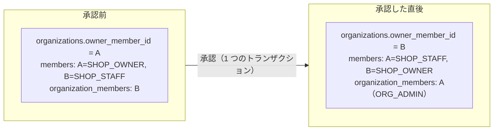

# オーナーの譲渡の DB 設計の経緯（2026-11-19）

対象の issue：abeouga/kusakari-ec#190（親）、#197（DB）、#195・#196・#198・#199・#181
DB の定義：[V1__schema.sql（7fa40d5）](https://github.com/abeouga/kusakari-ec/blob/7fa40d5/backend/src/main/resources/db/migration/V1__schema.sql)

## Context

組織のオーナーを別の人に譲渡する仕組み（#190）で、一度は「交代から 7 日間を移行期間にし、その間は元オーナーもオーナーのまま残す」と決めていました（#195 の決めること 5）。
7 日間を置いたのは、間違えて譲渡したときに、すぐに切り替えると取り返しがつかないためです。
本当の目的は「元オーナーが、7 日以内なら新しいオーナーを取り消せること」でした。

今の DB では、この 7 日間をそのまま表せません。

- オーナーは `organizations.owner_member_id` の 1 列で、一意キーがある
- `organizations(owner_member_id, owner_account_type)` → `members(id, account_type)` の複合外部キーと、`owner_account_type = 'SHOP_OWNER'` の CHECK がある
- `organization_members` には `member_account_type = 'SHOP_STAFF'` の CHECK があり、SHOP_OWNER の人を入れられない
- 組織に属している会員の `account_type` は、`organization_members` の行を外さないと変えられない（複合外部キーのため）
- `store_members` は `organization_members` を ON DELETE CASCADE で参照していて、組織から外すと店舗の担当も消える

そのため、7 日間をどう DB で持つかを #197 で検討しました。

## Decision

**移行期間は設けず、譲渡先が承認した時点ですぐにオーナーを交代します。**
DB で移行期間を保証することはせず、譲渡の可否や操作の制限は画面と Java の処理（`StaffPolicy` など）で制御します。
DB は今の作り（`organizations.owner_member_id` と `organization_members`）のままにし、#194 で決めた承認待ちの 2 列（`pending_owner_member_id`・`pending_owner_expires_at`）だけを足します。

承認したときは、1 つのトランザクションで次の順に付け替えます（外部キーと CHECK のため、この順でないと失敗します。順番の確定は #197 の 8）。

1. 新オーナーの `organization_members` の行を消す（`store_members` の担当も消える。#195 の 1 と合う）
2. 新オーナーの `members.account_type` を `SHOP_OWNER` にする
3. `organizations.owner_member_id` を新オーナーにする
4. 元オーナーの `members.account_type` を `SHOP_STAFF` にする
5. 元オーナーを `organization_members` に `role = 'ORG_ADMIN'` で入れる
6. `pending_owner_member_id`・`pending_owner_expires_at` を NULL にする
7. `organization_member_events` に `owner_succession_approval` を記録する（#196）

オーナーは常に 1 人で、#102 の「オーナーは 1 組織に 1 人」に例外はありません。

作らないもの：

- 7 日間オーナーが 2 人いる状態
- 7 日後に元オーナーを ORG_ADMIN に切り替える処理（定期処理、ログイン時に期限を見て切り替える処理）
- 移行期間中に元オーナーが譲渡を取り消す処理
- そのための列や表（下の Alternatives の列と表すべて）

## Alternatives

検討した順に書きます。
どれも「7 日間の状態を DB で表す」ための案で、移行期間をやめたので採用しません。

### 案A：組織の表に、元オーナーと期限の列を足す

`organizations` に `previous_owner_member_id` と `previous_owner_until`（または `owner_changed_at`）を足し、`owner_member_id` は承認の時点で新オーナーに付け替えます。
取り消しの権利は「`previous_owner_member_id` が本人で、期限内」で決めます。

採用しなかった理由：元オーナーを組織に入れる仕組み（ORG_ADMIN としての所属）と、取り消しの権利が別々の場所にあり、列の意味が読み取りにくいためです。
もう一度の譲渡を許すと、列が 1 人分なので元オーナーを表しきれません。

### 案B：オーナーの表を別に作る

`organization_owners` に、新旧のオーナーと、それぞれの期限を行で持ちます。

採用しなかった理由：`owner_member_id` を見ている認可（`StaffPolicy`、`AuthService` の `findByOwnerMemberId`）、通知（`NotificationService`、`OrganizationSuspensionService`）、画面をすべて直す必要があるためです。

### 案D：元オーナーを交代した時点で ORG_ADMIN にし、オーナーと同じ権限を持つ期限を持たせる

`organization_members` に `owner_privileges_until` を足し、認可では「オーナーの列にいる人」か「`owner_privileges_until` が現在時刻より後の人」をオーナーとして扱います。
7 日後に DB を書き換える処理は要りません。

採用しなかった理由：ORG_ADMIN の行が、期限の列によってオーナーと同じ強さを持つという形が直感的でないためです。
期限を過ぎた値が、担当者の行にいつまでも残ります。
`account_type = 'SHOP_OWNER'` でオーナーを判定している箇所（`AuthService` の 6 か所、`StaffPolicy`、`MemberService`、フロントの `Workspace.jsx`）をすべて直す必要もあります。

### 案E：7 日たってから切り替える（遅れて有効になる）

承認しても 7 日間は何も切り替えず、7 日後に定期処理で一度だけ切り替えます。
その間は元オーナーが取り消せます。

採用しなかった理由：承認した後の 7 日間に何も起きないので、「移行期間」ではなく「待機期間」になり、目的に合いません。
7 日後に `owner_member_id` などを書き換える定期処理も要ります。

### 案F：譲渡の表を作り、すぐ切り替えて 7 日以内なら取り消せるようにする

`organization_owner_transfers` で 1 回の譲渡を 1 行で持ちます（`from_member_id`・`to_member_id`・`status`・`approved_at`・`revocable_until`・`to_member_previous_role` など）。
承認の時点で切り替え、7 日以内なら元オーナーが取り消せます。
取り消しの権利は、ロールではなく「この譲渡の `from_member_id` が本人で、期限内」で決めます。

採用しなかった理由：取り消しのために、新オーナーの元のロールと担当店舗（`organization_owner_transfer_stores`）を残し、承認の逆順で戻す処理が要り、作りと保守が重いためです。
期限内に新オーナーが元オーナーを外す・無効にする・もう一度譲渡する、を禁止する処理も要ります。

### 案G：オーナーも `organization_members` のロールにまとめる作り直し

`organizations.owner_member_id` をなくし、オーナーを `organization_members.role = 'OWNER'` で表します。
`members.account_type` の `SHOP_OWNER` と `SHOP_STAFF` は `SHOP_MEMBER` にまとめます。
「1 組織にオーナーは 1 人まで」は、OWNER の行にだけ値が入る生成列の一意キーで保証します。
承認は「ロール 2 行の書き換え」、取り消しは「書き戻し」だけになり、新オーナーの店舗の担当も消さずに済みます。

採用しなかった理由：#102 のテーブル構成、`docs/database-er.md`・`docs/member-roles.md`、オーナーを判定しているバックエンドとフロントの多くの箇所を作り直すことになり、移行期間をやめれば要らないためです。
「組織にオーナーが 0 人ではない」ことは、この形でも DB では保証できません。

## Consequences

- 間違えて譲渡したときに、元オーナーが自分で取り消す方法はありません。
  戻すには、新しいオーナーにもう一度譲渡してもらいます（#194 の流れで、元オーナーの承認が要ります）。
- 譲渡先が承認する前（30 分の承認待ち）なら、元オーナーは申し出を取り消せます（#194 の 5）。
  間違いを防ぐ手段は、この承認待ちの段階だけです。
- #198（7 日間にできる操作）は閉じました。
  #197 は「承認したときの DB の付け替え方」を決める issue に変えました。
- #181 の決めること 3 と #195 の決めること 5 は、「交代した時点で元オーナーは ORG_ADMIN になる」という当初の決定に戻しました。
- `organization_member_events` に、7 日後の切り替えの記録（仮：`owner_succession_transition_end`）は足しません。
  承認の記録（`owner_succession_approval`）が、そのまま交代の記録になります。
- 新オーナーは承認の時点で `organization_members` から外れるので、#195 の 1 の「組織には所属したまま」は、「`organizations.owner_member_id` で組織と結び付く」という意味になります（#197 の 4 で確定します）。
- 正式な決定の記録（ADR）は、#199 で kusakari-ec の `docs/decisions/` に書きます。
